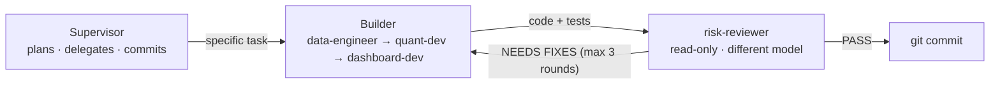

# SignalDesk

**A small Bloomberg-style portfolio risk dashboard, built by a team of AI agents with a skeptical
reviewer that checks every line before it is committed.**

[](https://github.com/karakusethem09/signaldesk/actions/workflows/tests.yml)


<sub>The demo portfolio vs SPY over 5 years. More screenshots: [Overview](docs/images/dashboard.png) · [Risk (drawdown, rolling volatility)](docs/images/dashboard-risk.png) · [Holdings table](docs/images/dashboard-holdings.png).</sub>

SignalDesk shows how a portfolio performed and how risky it was, side by side with a benchmark:
- annualized return, volatility and the Sharpe ratio
- max drawdown and Value at Risk
- rolling volatility and correlations

It opens on a **demo portfolio** (six US large caps vs SPY, 5 years) that works even when the data
provider is down. You can also build your own portfolio from live Yahoo Finance data. Every number is
calculated by our own tested Python functions.

The dashboard is the vehicle. **What I actually wanted to learn is how AI agents can work together
reliably.** So I didn't write the code myself. I designed a small team of AI agents, gave each one
a role and rules, and made one of them a read-only reviewer whose only job is to find the others'
mistakes.

---

## How it was built

I wrote the project rules ([`CLAUDE.md`](CLAUDE.md)) and the agent roles
([`.claude/agents/`](.claude/agents/)). Then I gave [Claude Code](https://claude.com/claude-code)
one prompt: act as the **supervisor**, build Phase 1 by delegating, and don't
write any code yourself. The [session journal](docs/sessions/2026-10-20-overnight-build.md) has the
full prompt and the morning report. Phase 1.5, which made it a public website, followed the same process:
[session 2 journal](docs/sessions/2026-10-21-phase-1-5-public-website.md).



| Agent | Model | Job | Can edit code? |
|---|---|---|---|
| Supervisor | Claude Opus | Plans, writes precise tasks, makes judgment calls, keeps the log, commits | No (by instruction) |
| `data-engineer` | Claude Sonnet | Downloads, cleans and caches prices; demo snapshot; request limits: [`signaldesk/data.py`](signaldesk/data.py), [`signaldesk/limits.py`](signaldesk/limits.py) | Yes |
| `quant-dev` | Claude Sonnet | All the math: [`signaldesk/risk.py`](signaldesk/risk.py) | Yes |
| `dashboard-dev` | Claude Sonnet | The Streamlit UI: [`app.py`](app.py) and [`ui/`](ui/), with no math allowed | Yes |
| `risk-reviewer` | Claude Opus | Re-checks numbers by hand, tests on real data, plants bugs to test the tests | **No, read-only** |

**The rules that make it work:**
- **Nothing gets committed until the reviewer says PASS**, or until 3 fix rounds have been used, with the
  leftovers logged.
- **The reviewer can't fix anything; it can only report.** That keeps it independent.
- **The reviewer runs on a different model** from the builders, so it doesn't share their blind spots.
- **Mutation testing:** the reviewer deliberately plants small bugs and checks whether any test fails.
  If none does, the tests have a blind spot.
- **All math lives in pure, tested functions.** In Phase 2 these become the tools the AI agents call, so
  an agent never invents a number.

---

## What the reviewer caught

The builders' tests all passed. The reviewer still found **31 real issues**, which were fixed, plus about
10 smaller ones that are logged for later. The three I find most interesting:

**1. It caught the supervisor's own mistake.** The supervisor gave quant-dev a rule for missing prices
that sounded careful but threw away real price moves. The reviewer tested it on real data: AAPL's
annual return read **21.7% on its own, but 28.8% when the table also held a German and a Japanese
stock**, because of their different holidays. Same stock, same dates. The rule was replaced, and 10 tests
now guard against it coming back. → [C1](docs/catch-log.md#c1-the-supervisors-gap-rule-distorted-returns)

**2. Fixes created new bugs, twice.** Fixing a frozen cache introduced a timezone bug: on a computer in
Tokyo, an unfinished midday price would be saved as the day's close forever. Fixing *that* combined with
another fix to report **52 fake missing days**. Each one was caught by re-reviewing after every fix.
→ [C3](docs/catch-log.md#c3-a-future-end-date-froze-the-cache) →
[C4](docs/catch-log.md#c4-the-fix-for-c3-used-the-wrong-clock) →
[C5](docs/catch-log.md#c5-two-fixes-together-reported-52-fake-missing-days)

**3. The tests passed, but didn't test.** The dashboard's numbers were correct, but when the reviewer
planted 16 realistic display bugs (a drawdown shown as "−28.4%", a percentage doubled to "2843.9%",
reversed heatmap colours), **13 of them passed every test**. After the fix, all 16 are caught.
→ [C2](docs/catch-log.md#c2-tests-checked-that-the-page-ran-not-what-it-showed)

**And in Phase 1.5, while making it public:**
- **A page reload reset the visitor rate limit.** A script could have sent about 1,000 Yahoo downloads
  an hour and had the server blocked for everyone. There is now a site-wide cap.
  → [C19](docs/catch-log.md#c19-reloading-the-page-reset-the-rate-limit)
- **The 10-year limit would have refused a "10Y" button on every single day,** because of leap days.
  The reviewer found it by checking all 2,922 days from 2026 to 2033.
  → [C14](docs/catch-log.md#c14-the-10-year-limit-refused-10y-every-day)
- **A late-starting holding silently shortened the portfolio,** so one year of portfolio would have
  been compared with five years of SPY. → [C18](docs/catch-log.md#c18-a-late-starting-holding-silently-shortened-the-portfolio)

Every catch is written up with its evidence, its fix and the lesson in the **[catch log](docs/catch-log.md)**.

---

## What I learned

**About AI agents working together**
- **A checker with a different role finds different bugs.** The builders implemented their specs well.
  The reviewer questioned the *spec itself*, tested against *real* data, and combined functions the
  way a real user would.
- **"The tests pass" is not the same as "the tests test something."** Planting bugs on purpose (mutation
  testing) is the fastest way to tell the difference.
- **Every fix needs its own review.** Three of the bugs above were created by earlier fixes.
- **The supervisor needs checking too.** The most serious mistake of the build came from the agent giving
  the orders, and it was caught by the agent with the least power.
- **Context matters.** Sending fixes back to the same builder was fast, because it remembered its code.
  Using a fresh reviewer for each layer kept the reviews independent.

**About financial data**
- How you handle a single missing price can change a stock's annual return by several percentage points.
- "Today" depends on where you are. Markets use exchange-local dates, and the date on your own clock can
  sneak an unfinished trading day into your data.
- Annualizing a tiny sample produces absurd numbers (3 days of a meme stock gives a CAGR around 10^61).
  That's why every statistic warns below 60 trading days.
- "Adjusted" prices change over time, because Yahoo rescales history after every dividend.

---

## Features

- **Two modes:**
  - **Demo portfolio (default):** AAPL, MSFT, NVDA, JPM, XOM and JNJ vs SPY, from a committed 5-year
    snapshot. It works offline and opens instantly.
  - **Custom (live data):** type your own holdings and weights (in %) and a benchmark, then press
    *Run analysis*. Nothing is downloaded before that.
- **Key numbers:** annualized return, volatility, Sharpe ratio, max drawdown and 1-day 95% VaR for
  the portfolio, with the benchmark's value under each, **measured over the same dates**.
- **Tabs:**
  - **Overview:** growth of $1 (buy-and-hold).
  - **Risk:** the drawdown ("underwater") curve and rolling volatility.
  - **Correlation:** a heatmap.
  - **Holdings:** a per-ticker table.
  - **Data:** data quality.
  - **About:** how it was built.
- **Honest warnings on the page:**
  - short samples (⚠ below 60 trading days)
  - gaps in the data
  - a holding that starts later than the others
  - tickers that can't be calculated
- **Safe for a public site:**
  - limits per visitor and site-wide
  - one download at a time
  - error details never shown to visitors

## Run it yourself

```bash
git clone https://github.com/karakusethem09/signaldesk.git
cd signaldesk
python3 -m venv .venv
source .venv/bin/activate
pip install -r requirements-dev.txt      # the app's packages plus pytest

SIGNALDESK_MODE=local streamlit run app.py   # your own analysis, no request limits
streamlit run app.py                         # same as the public site (limits on)
pytest -q                                    # 1,319 tests, all offline, about 30 seconds
```

To refresh the demo snapshot, run `python scripts/refresh_demo_data.py` and commit `data/demo/`.

## Project structure

```
signaldesk/
├── app.py                  # Streamlit entry point
├── ui/                     # the dashboard: layout, charts, formatting (no math, enforced by tests)
├── signaldesk/
│   ├── data.py             # download, clean, cache prices; demo snapshot; report gaps
│   ├── risk.py             # all the math; pure functions with warnings
│   └── limits.py           # request limits for the public site
├── data/demo/              # committed 5-year snapshot for the demo portfolio
├── scripts/                # refresh_demo_data.py
├── tests/                  # 1,319 offline tests
├── docs/
│   ├── catch-log.md        # every mistake an agent caught, with evidence
│   ├── decisions.md        # design decisions and why
│   └── sessions/           # journal of each build session
├── .github/workflows/      # CI: the test suite on every push
├── .streamlit/config.toml  # public-site settings (no error details for visitors)
├── .claude/agents/         # the four agent role definitions
└── CLAUDE.md               # project rules every agent follows
```

## Tests

- **1,319 tests**, all offline. They pass even with the network blocked at the socket and libcurl level,
  and they never touch the real price cache. They run on every push via GitHub Actions.
- **Math tests use hand-checkable examples.** For example, prices `[100, 110, 99]` must give
  returns `[0.10, −0.10]`, and the arithmetic is written in the test's comments.
- **Dashboard tests read what the browser actually gets.** They check every table cell and every
  chart's data against `risk.py`.
- **A guard test scans every UI file and chart spec** and fails if any arithmetic sneaks into the
  dashboard.
- **Planted-bug check:** the reviewer's planted bugs are caught by the suite. In its last WP3 review,
  58 of 59 were caught, and the survivor was fixed afterwards.

---

## Roadmap

**Phase 1, the dashboard, is done.**

**Phase 1.5, the public website, is done.** It added the demo portfolio, limits, CI and a
professional layout.

**Phase 2 is the agents, built one at a time with the Anthropic SDK.** First comes a preparation step:
`risk.py` will return its warnings as data rather than Python warnings. That fixes the one known
multi-visitor issue ([C21](docs/catch-log.md#c21-a-visitors-warnings-can-get-lost-between-threads))
and gives the agents structured diagnostics. Then:
1. **Quant agent:** answers questions only by calling the Phase-1 functions. It never writes a number
   that didn't come from a tool call.
2. **Macro agent:** inflation and interest rates (FRED).
3. **Filings agent:** company filings (SEC EDGAR), with chunking for long documents.
4. **Risk agent:**
   - challenges the other agents' claims: can each number be traced to a tool output?
   - checks whether the sample is long enough
   - checks for look-ahead bias
   - checks whether agents contradict each other

**Goal:** show the risk agent catching a deliberately planted mistake (a sample period that is too short).
The Phase-1 warnings (`ShortSampleWarning`, `GapWarning`, `n_obs`) are already the hooks it will use.

## Built with

Python 3.13 · pandas · NumPy · yfinance · Streamlit · Altair · pytest ·
Claude Code (Claude Opus as supervisor and reviewer, Claude Sonnet as builders)

---

*This is a learning project and not investment advice. Price data comes from Yahoo Finance via
`yfinance`.*
