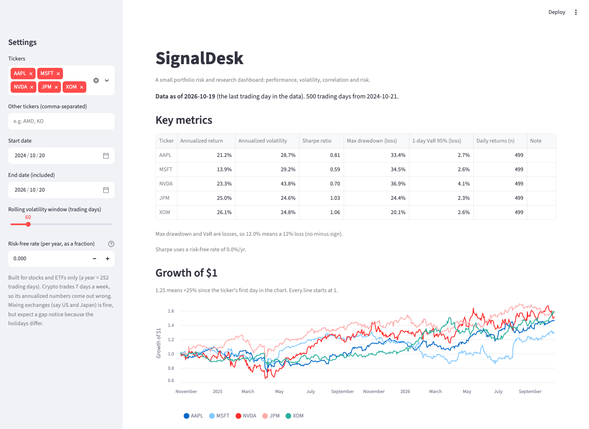
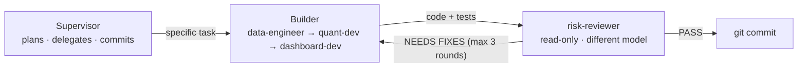

# SignalDesk

**A small Bloomberg-style portfolio risk dashboard, built by a team of AI agents with a skeptical
reviewer that checks every line before it is committed.**


<sub>Top of the dashboard. [Full screenshot](docs/images/dashboard.png), including the rolling volatility chart and the correlation heatmap.</sub>

SignalDesk shows how a handful of stocks performed and how risky they were: annualized return,
volatility, Sharpe ratio, max drawdown, Value at Risk, rolling volatility and correlations. All of
it is calculated by our own tested Python functions.

The dashboard is the vehicle. **What I actually wanted to learn is how AI agents can work together
reliably.** So I didn't write the code myself. I designed a small team of AI agents, gave each one
a role and rules, and made one of them a read-only reviewer whose only job is to find the others'
mistakes.

---

## How it was built

I wrote the project rules ([`CLAUDE.md`](CLAUDE.md)) and the agent roles
([`.claude/agents/`](.claude/agents/)). Then I gave [Claude Code](https://claude.com/claude-code)
one prompt: act as the **supervisor**, build Phase 1 by delegating, and don't
write any code yourself. The [session journal](docs/sessions/2026-10-20-overnight-build.md) has the
full prompt and the morning report.



| Agent | Model | Job | Can edit code? |
|---|---|---|---|
| Supervisor | Claude Opus | Plans, writes precise tasks, makes judgment calls, keeps the log, commits | No (by instruction) |
| `data-engineer` | Claude Sonnet | Downloads, cleans and caches prices: [`signaldesk/data.py`](signaldesk/data.py) | Yes |
| `quant-dev` | Claude Sonnet | All the math: [`signaldesk/risk.py`](signaldesk/risk.py) | Yes |
| `dashboard-dev` | Claude Sonnet | The Streamlit UI: [`app.py`](app.py), with no math allowed | Yes |
| `risk-reviewer` | Claude Opus | Re-checks numbers by hand, tests on real data, plants bugs to test the tests | **No, read-only** |

**The rules that make it work:**
- **Nothing gets committed until the reviewer says PASS**, or until 3 fix rounds have been used, with the
  leftovers logged.
- **The reviewer can't fix anything; it can only report.** That keeps it independent.
- **The reviewer runs on a different model** from the builders, so it doesn't share their blind spots.
- **Mutation testing:** the reviewer deliberately plants small bugs and checks whether any test fails.
  If none does, the tests have a blind spot.
- **All math lives in pure, tested functions.** In Phase 2 these become the tools the AI agents call, so
  an agent never invents a number.

---

## What the reviewer caught

The builders' tests all passed. The reviewer still found **31 real issues**, which were fixed, plus about
10 smaller ones that are logged for later. The three I find most interesting:

**1. It caught the supervisor's own mistake.** The supervisor gave quant-dev a rule for missing prices
that sounded careful but threw away real price moves. The reviewer tested it on real data: AAPL's
annual return read **21.7% on its own, but 28.8% when the table also held a German and a Japanese
stock**, because of their different holidays. Same stock, same dates. The rule was replaced, and 10 tests
now guard against it coming back. → [C1](docs/catch-log.md#c1-the-supervisors-gap-rule-distorted-returns)

**2. Fixes created new bugs, twice.** Fixing a frozen cache introduced a timezone bug: on a computer in
Tokyo, an unfinished midday price would be saved as the day's close forever. Fixing *that* combined with
another fix to report **52 fake missing days**. Each one was caught by re-reviewing after every fix.
→ [C3](docs/catch-log.md#c3-a-future-end-date-froze-the-cache) →
[C4](docs/catch-log.md#c4-the-fix-for-c3-used-the-wrong-clock) →
[C5](docs/catch-log.md#c5-two-fixes-together-reported-52-fake-missing-days)

**3. The tests passed, but didn't test.** The dashboard's numbers were correct, but when the reviewer
planted 16 realistic display bugs (a drawdown shown as "−28.4%", a percentage doubled to "2843.9%",
reversed heatmap colours), **13 of them passed every test**. After the fix, all 16 are caught.
→ [C2](docs/catch-log.md#c2-tests-checked-that-the-page-ran-not-what-it-showed)

Every catch is written up with its evidence, its fix and the lesson in the **[catch log](docs/catch-log.md)**.

---

## What I learned

**About AI agents working together**
- **A checker with a different role finds different bugs.** The builders implemented their specs well.
  The reviewer questioned the *spec itself*, tested against *real* data, and combined functions the
  way a real user would.
- **"The tests pass" is not the same as "the tests test something."** Planting bugs on purpose (mutation
  testing) is the fastest way to tell the difference.
- **Every fix needs its own review.** Three of the bugs above were created by earlier fixes.
- **The supervisor needs checking too.** The most serious mistake of the build came from the agent giving
  the orders, and it was caught by the agent with the least power.
- **Context matters.** Sending fixes back to the same builder was fast, because it remembered its code.
  Using a fresh reviewer for each layer kept the reviews independent.

**About financial data**
- How you handle a single missing price can change a stock's annual return by several percentage points.
- "Today" depends on where you are. Markets use exchange-local dates, and the date on your own clock can
  sneak an unfinished trading day into your data.
- Annualizing a tiny sample produces absurd numbers (3 days of a meme stock gives a CAGR around 10^61).
  That's why every statistic warns below 60 trading days.
- "Adjusted" prices change over time, because Yahoo rescales history after every dividend.

---

## Features

- **Metrics table:**
  - annualized return, annualized volatility, Sharpe ratio, max drawdown and 1-day 95% VaR, per ticker
  - short samples flagged with ⚠
  - tickers that can't be computed are shown as "—", with the reason
- **Charts:**
  - growth of $1
  - rolling volatility (choose the window)
  - correlation heatmap
- **Warnings shown on the page:**
  - short samples
  - gaps in the data, with "likely missing data" when a gap is longer than a holiday
  - skipped tickers
- **Data quality panel:** blank cells per ticker, and weekdays with no data (mostly market holidays).
- **Any Yahoo Finance ticker** for stocks and ETFs, including non-US exchanges.

## Run it yourself

```bash
git clone https://github.com/karakusethem09/signaldesk.git
cd signaldesk
python3 -m venv .venv
source .venv/bin/activate
pip install -r requirements.txt

streamlit run app.py      # opens the dashboard in your browser
pytest -q                 # 371 tests, all offline, about 5 seconds
```

## Project structure

```
signaldesk/
├── app.py                  # Streamlit dashboard (UI only, no math)
├── signaldesk/
│   ├── data.py             # download, clean, cache prices; report gaps
│   └── risk.py             # all the math; pure functions with warnings
├── tests/                  # 371 offline tests: data 108 · risk 214 · app 49
├── docs/
│   ├── catch-log.md        # every mistake an agent caught, with evidence
│   ├── decisions.md        # design decisions and why
│   └── sessions/           # journal of each build session
├── .claude/agents/         # the four agent role definitions
└── CLAUDE.md               # project rules every agent follows
```

## Tests

- **371 tests**, all offline: no internet needed, and they never touch the real price cache.
- **Math tests use hand-checkable examples.** For example, prices `[100, 110, 99]` must give
  returns `[0.10, −0.10]`, and the arithmetic is written in the test's comments.
- **Dashboard tests read what the user actually sees.** They check the rendered text and the
  chart data against `risk.py`.
- **Planted-bug check:** the reviewer's planted bugs are caught by the suite:
  - data: every planted bug in the final review
  - math: 65 of 68 (the other 3 are harmless)
  - dashboard: 16 of 16

---

## Roadmap

**Phase 1, the dashboard, is done.**

**Phase 2 is the agents, built one at a time with the Anthropic SDK:**
1. **Quant agent:** answers questions only by calling the Phase-1 functions. It never writes a number
   that didn't come from a tool call.
2. **Macro agent:** inflation and interest rates (FRED).
3. **Filings agent:** company filings (SEC EDGAR), with chunking for long documents.
4. **Risk agent:**
   - challenges the other agents' claims: can each number be traced to a tool output?
   - checks whether the sample is long enough
   - checks for look-ahead bias
   - checks whether agents contradict each other

**Goal:** show the risk agent catching a deliberately planted mistake (a sample period that is too short).
The Phase-1 warnings (`ShortSampleWarning`, `GapWarning`, `n_obs`) are already the hooks it will use.

## Built with

Python 3.13 · pandas · NumPy · yfinance · Streamlit · Altair · pytest ·
Claude Code (Claude Opus as supervisor and reviewer, Claude Sonnet as builders)

---

*This is a learning project and not investment advice. Price data comes from Yahoo Finance via
`yfinance`.*
